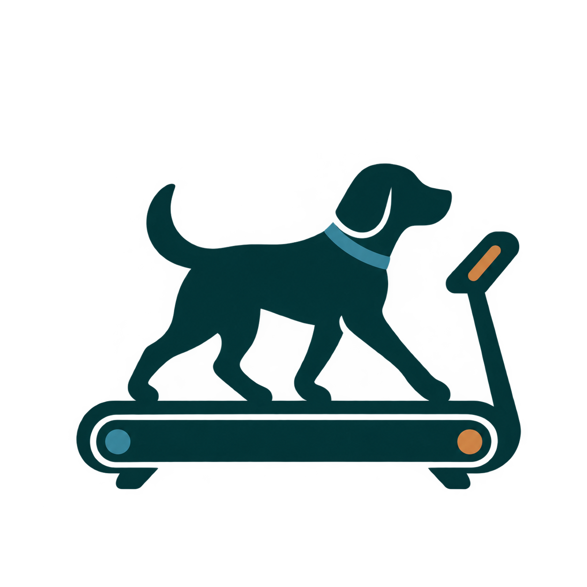

# 🐾 PetFit Sync

PWA de Gestão de Hábitos para **Pets e Tutores**.

> **Versão atual:** 8.0 | **Sem sincronização manual, modo debug 🔧 e créditos do app**

---

## 📜 Histórico de Versões

### 🏁 v8.0 — Versão final: modo debug e créditos
> *App mais enxuto, com uma demonstração pronta e a tela de créditos*

- ✅ **Sincronização manual removida**: saíram o botão **Sincronizar** da barra inferior e o gesto de **puxar para baixo para atualizar** (indicador, textos e estilos incluídos). Os dados continuam salvos automaticamente a cada ação.
- ✅ **Botão "Novo Hábito" centralizado**: agora é o único botão da barra inferior, no centro da tela.
- ✅ **Modo debug 🔧**: um ícone de chave inglesa pequeno nos **Ajustes**, ao lado de "PetFit v8.0". Ao tocar, carrega um **perfil de demonstração** e abre a "Evolução da Dupla" com o histórico de 7 dias: **altos e baixos na segunda e na terça**, **crescimento a partir da quarta** até o sábado, e **queda no domingo**. Tocar no 🔧 de novo (ou recarregar a página) volta aos seus dados.
- ✅ **Debug seguro**: no modo debug nada é gravado, então seus dados reais não são sobrescritos mesmo que você marque hábitos durante a demonstração.
- ✅ **Debug desativável pelo VSCode**: veja **"Como desativar o modo debug"** abaixo.
- ✅ **Créditos do app**: nova opção nos **Ajustes**, logo abaixo de "Restaurar dados da dupla". Abre um modal com mensagem de agradecimento, o logo do PetFit e **3 criadores** em fotos circulares, com o nome embaixo. As fotos e os nomes são editados direto no `index.html` (veja **"Como editar os criadores"**).
- ✅ **Histórico: barra de "hoje" corrigida**: a barra do dia atual agora mostra o progresso do dia ao vivo. Antes ela ficava vazia até o dia virar.

---

### 🧭 v7.0 — Exercícios que combinam com a tarefa
> *O exercício sugerido nunca atrapalha o que você está fazendo com o pet*

- ✅ **Exercícios ligados ao contexto**: o app agora escolhe o exercício pela **categoria**, pelo **título** e pelo **horário** do hábito, e não só pela categoria. Quem anda com o cachorro recebe exercícios de pé, com uma mão livre para a guia; quem dá banho recebe exercícios sem salto, por causa do piso molhado.
- ✅ **77 exercícios** (eram 42), organizados nas 7 categorias do app: Alimentação, Passeio, Medicação, Escovação, Brincadeira, Higiene e Outro.
- ✅ **Etiqueta de momento** no cartão do exercício: *"🦮 Durante o passeio"*, *"💊 Depois da medicação"*, *"🍖 Antes da alimentação"*. Cada exercício diz **quando** fazer em relação à tarefa (antes, durante ou depois).
- ✅ **Subcontextos pelo título do hábito**: palavras no título ativam exercícios específicos. Exemplos: *"Passeio no parque"* libera tiros de corrida em área segura; *"Troca de água"* sugere agachar ao colocar o bebedouro; *"Brincar de bola"* sugere agachar a cada arremesso; *"Limpar caixa de areia"* sugere agachar com as costas retas. A tabela completa está em **"Como os exercícios são escolhidos"**.
- ✅ **Regra de horário**: hábitos à noite (a partir das 19h, antes das 6h, ou com "noite"/"noturno" no título) não recebem polichinelos, pulos, tiros de corrida nem escadas, por causa do barulho e da pouca luz.
- ✅ **Dica de segurança no lugar certo**: a frase em itálico abaixo do exercício agora é específica da tarefa (ex.: *"Nunca enrole a guia na mão e corra só onde não há trânsito"*), e não mais uma dica genérica.
- ✅ **7 vídeos novos** (27 no total): equilíbrio em um pé só, respiração diafragmática, alongamento de pescoço, gato-camelo, alongamento de panturrilha, de quadríceps e de posterior de coxa.
- ✅ **Exercícios de alongamento e relaxamento**: depois do passeio e da brincadeira entram alongamentos das pernas; antes de medicar ou cortar as unhas entram respiração e aquecimento de punhos, para deixar as mãos firmes e o pet mais calmo.
- ✅ **Sem repetição seguida**: o mesmo exercício não aparece duas vezes em sequência.

---

### 🎬 v6.0 — Exercícios com Vídeo-Tutorial
> *Exercícios pensados para o momento de cada tarefa, com ajuda em vídeo a um toque*

- ✅ **Banco de exercícios revisado**: 42 exercícios (6 por categoria), escolhidos para fazer sentido durante a tarefa — parado na cozinha na **alimentação**, aproveitando as pausas do pet no **passeio**, calmos e silenciosos na **medicação**, sem saltos na **higiene** (piso molhado), e assim por diante.
- ✅ **Filtro por categoria**: cada exercício vem das mesmas 7 categorias dos hábitos (alimentação, passeio, medicação, escovação, brincadeira, higiene e outro).
- ✅ **Ajuda discreta no modal do exercício**: logo abaixo do exercício aparece *"Não sabe realizar? Veja esse vídeo no YouTube!"* com o botão **▶ Ver vídeo**, que abre o tutorial em outra aba (o modal continua aberto para você voltar e concluir o hábito).
- ✅ **20 vídeos em português**, um por tipo de exercício (agachamento, prancha, polichinelo, mobilidade de ombros etc.). Exercícios parecidos de categorias diferentes compartilham o mesmo vídeo.
- ✅ **Sem repetir seguido**: o mesmo exercício não aparece duas vezes em sequência na mesma categoria.
- ✅ **Acessível e fiel ao tema**: botão com área de toque ≥ 48px, `aria-label` com o nome do exercício, e cores que acompanham o tema claro/escuro.
- ✅ **Fácil de manter**: para trocar um vídeo, basta mudar o `id` em `ExerciseVideos` no `script.js` (veja **"Como trocar um vídeo"** abaixo).

---

### 🐾 v5.0 — Personalização do Perfil
> *Personalização da identidade visual da dupla pet + tutor*

- ✅ **Perfil personalizado da dupla**: exibição das informações do pet e do tutor em uma única seção.
- ✅ **Foto do pet no cabeçalho**: o ícone superior passa a representar o pet cadastrado.
- ✅ **Fotos e nomes no perfil**: apresentação das fotos e dos nomes do pet e do tutor, junto das estatísticas existentes.
- ✅ **Nomes somente para visualização no perfil**: os campos de nome não permitem edição direta nessa tela.
- ✅ **Persistência local**: suporte ao armazenamento das informações e da foto do perfil no `localStorage`.

---

### 🚀 v1.0 — Fundação
> *Lançamento inicial com conceito Thumb-Friendly*

- ✅ **Acompanhamento Duplo**: Hábitos do pet + exercícios para o tutor
- ✅ **Microexercícios Dinâmicos**: Sugestões por categoria (alimentação, passeio, medicação, etc.)
- ✅ **Energia da Dupla**: Indicador visual de sintonia pet + tutor
- ✅ **Thumb-Friendly Zone**: Navegação inferior, ações na base, touch targets ≥48px
- ✅ **PWA Completo**: Manifest, Service Worker, offline support
- ✅ **localStorage**: Persistência local de dados
- ✅ **Reset Diário Automático**: Hábitos resetam a cada dia com histórico
- ✅ **7 Hábitos Padrão**: Alimentação, passeio, escovação, medicação, brincadeira
- ✅ **Dark/Warm Theme**: Paleta off-white + laranja coral
- ✅ **Fonte Inter**: Ótima legibilidade mobile
- ✅ **Swipe-to-Dismiss nos Modais**: Fechar arrastando para baixo
- ✅ **Haptic Feedback**: Vibração sutil nos botões

---

### 🔥 v2.0 — Skeletons + Firebase
> *Estados de carregamento e camada de dados abstrata*

#### 🦴 Skeleton Screens
- Skeleton com **efeito shimmer** em toda a interface
- Estados de carregamento em: Progresso do Dia, Energia da Dupla, Lista de Hábitos
- **Fade suave** ao trocar skeleton → conteúdo real
- Simula latência de rede para garantir visualização do skeleton

#### 🔥 DataLayer — Firebase-ready
- **Camada de dados abstrata**: troque `localStorage` ↔ `Firebase Firestore` com 1 linha
- Driver `localStorage` (padrão, zero config, offline)
- Driver `Firebase` (cloud, sincronização entre dispositivos)
- Autenticação anônima integrada
- Para ativar: mude `useFirebase: true` e descomente os SDKs

---

### 👆 v3.0 — Gestures
> *Navegação por gestos nativos de mobile*

#### ⬇️ Pull-to-Refresh *(removido na v8.0)*
- Puxar a lista para baixo para sincronizar dados. Foi retirado na v8.0, junto com o botão Sincronizar.

#### 👈👉 Swipe nos Cards de Hábito
- **Deslize para a ESQUERDA** → Completa o hábito (abre modal de exercício)
- **Deslize para a DIREITA** → Desmarca o hábito (se já estiver concluído)
- Background colorido revela a ação durante o swipe
- Snap automático com animação elástica

#### 👆 Long-Press (Toque Longo)
- **Segure** qualquer card de hábito por 500ms
- Abre **menu de contexto** com opções:
  - ✅ Concluir / ↩️ Desmarcar
  - 💪 Ver exercício
  - ✏️ Editar (em breve)
  - 🗑️ Excluir
- Vibração tátil ao ativar (haptic feedback)
- Fecha ao tocar fora do menu

#### 💡 Gesture Hint
- Banner educativo na primeira abertura explicando os gestos
- "Deslize o hábito para ações rápidas · Segure para menu"
- Fecha permanentemente após dismiss (salvo no localStorage/Firebase)

---

### 🌗 v4.0 — Dark Mode + Microinterações + Tipografia
> *Identidade de marca, conforto visual e feedback em cada toque*

#### 🎨 Nova paleta de marca

| Cor | Hex | Onde aparece |
|---|---|---|
| Verde-petróleo escuro | `#0E3032` | Fundo do tema escuro · texto principal no tema claro |
| Verde-petróleo profundo | `#043F41` | Header (tema claro) · cards e barras (tema escuro) |
| Azul-acinzentado | `#4994A9` | Hábito concluído · destaques secundários |
| Âmbar | `#D8914F` | Botões, chip ativo, barra de progresso |
| Ferrugem | `#8A441E` | Textos de destaque no tema claro · ação de excluir |

- A paleta fica em um só lugar: variáveis `--pal-*` no topo do `style.css`. Trocou ali, trocou o app inteiro.
- **Contraste verificado (WCAG AA)**: texto sobre o âmbar usa `#0E3032` (5,4:1) em vez de branco (2,6:1). No tema escuro, o texto de destaque usa um âmbar mais claro derivado da paleta.
- Como a paleta não tem vermelho, ações destrutivas usam o ferrugem `#8A441E`.

#### 🌙 Dark Mode Adaptativo
- **3 modos**: Automático (acompanha o aparelho, inclusive quando ele muda no meio do uso), Claro e Escuro
- **Botão rápido** ☾/☀ no topo + opção completa em **Ajustes**
- Preferência salva no aparelho e aplicada **antes da primeira pintura** (sem "flash" branco ao abrir)
- A barra de status do celular (`theme-color`) acompanha o tema
- Troca com **revelação circular** a partir do botão tocado (View Transitions); em navegadores sem suporte, fade suave de cores
- Fundo escuro `#0E3032`: tons escuros reduzem o consumo em telas OLED

#### ✨ Microinterações Progressivas
- **Check animado**: o ✓ é "desenhado" ao concluir, com pop e anel de onda no botão
- **Confete e patinhas 🐾** ao concluir um hábito; **celebração extra ao bater 100%** do dia
- **Reordenação animada (FLIP)**: o card concluído desliza até a nova posição
- **Entrada em cascata** dos cards ao abrir ou trocar de filtro
- **Contadores** animados (progresso, perfil e evolução) e **barras do histórico** que crescem
- **Swipe com feedback progressivo**: só a ação da direção do dedo aparece, o ícone cresce até o limite, "arma" com vibração e volta com mola
- **Excluir** com animação de saída; **campo vazio** balança (shake) com vibração
- **Ripple** nos botões e chips; indicador da aba ativa desliza; ícone de energia dá um "pulinho" quando muda
- **Sem dependências**: feito com CSS + Web Animations API. (Framer Motion é só para React e o Lottie exige arquivos `.json` + CDN; assim o app continua leve e offline.)
- **Progressivo e acessível**: tudo respeita "Reduzir movimento" do sistema, e a revelação circular só existe onde o navegador suporta

#### 🔤 Tipografia Escalonável e Hierárquica
- **Escala fluida de 7 níveis** (`--fs-xs` → `--fs-3xl`) com `clamp()`: cresce suavemente de 320px a 480px de largura
- **Hierarquia clara**: Display (progresso do dia em destaque) → Título → Subtítulo → Corpo → Metadados → Legendas
- **Escalona de verdade**: base em `rem`, fonte do aparelho respeitada (`100%`) e **Ajustes → Tamanho do texto** (Padrão · Grande · Maior = 100% · 112,5% · 125%)
- **Zoom liberado**: removido `user-scalable=no` do viewport
- Menor texto subiu de 10px para **12px**; números tabulares, títulos balanceados e nomes de hábito em até 2 linhas (antes cortavam com "…")

#### 🖼️ Logo no header
- Ao lado de "PetFit Sync", dentro de um **quadrado branco com cantos levemente arredondados**: o PNG nunca fica estranho, em qualquer tema ou cor de fundo
- Se o PNG não existir ou falhar, aparece 🐾 no lugar
- Veja **"Como trocar o logo"** abaixo

#### 🛠️ Correções (encontradas ao preparar a v4.0)
- **Concluir & Marcar Hábito** não fechava o modal e contava o exercício em dobro: `renderAll()` chamava `renderStats()`, que não existia
- **Salvar Perfil** travava (`saveProfile` chamava a si mesmo até estourar a pilha)
- **Toque simples** num card abria o modal de exercício (swipe "fantasma")
- O banner de gestos agora fecha e lembra a escolha

---

## 📁 Estrutura

```
petfit-sync/
├── index.html       ← Header com logo + botão de tema, Ajustes (🔧 debug e Créditos), modal de exercício com botão de vídeo, modal de Créditos
├── style.css        ← Paleta + tema claro/escuro + escala tipográfica + animações
├── script.js        ← DataLayer + ExerciseVideos/ExerciseDB + Skeletons + Gestures + Motion + ThemeManager + App + DebugMode
├── manifest.json    ← PWA manifest (cores da marca)
└── assets/
    ├── criadores/           ← fotos dos criadores (veja o LEIA-ME.txt desta pasta)
    └── icons/
        ├── logo.png         ← SEU LOGO do header e dos créditos (substitua este arquivo)
        ├── Petfitlogo.png   ← Favicon
        ├── iconavatar1.png  ← Avatar padrão (placeholder dos criadores)
        └── icon-*.svg       ← Placeholders (substitua por PNGs reais)
```

---

## 🔧 Como desativar o modo debug

No `script.js`, procure a **SEÇÃO 8: MODO DEBUG** (perto do final do arquivo). Escolha **uma** das opções:

```js
// Opção 1 (mais simples): comente a linha da flag com //
// const PETFIT_DEBUG = true;

// Opção 2: troque true por false
const PETFIT_DEBUG = false;

// Opção 3: selecione o bloco inteiro da SEÇÃO 8 e use Ctrl + /
```

Nas três opções o ícone 🔧 some dos Ajustes e **o resto do app continua funcionando normalmente**, sem erro no console. Para reativar, desfaça o comentário.

### Curva da semana na demonstração

| Seg | Ter | Qua | Qui | Sex | Sáb | Dom |
|---|---|---|---|---|---|---|
| 65% | 40% | 55% | 70% | 85% | 100% | cai (hábitos do dia) |

Os valores ficam em `DebugMode.curve` (por dia da semana, de 0 = domingo a 6 = sábado) e podem ser ajustados. A quantidade de exercícios da demonstração está em `DebugMode.exercisesDone`.

---

## ✨ Como editar os criadores

Abra o `index.html` e procure por **EDITE AQUI: FOTOS E NOMES DOS CRIADORES**. Para cada um dos 3 criadores:

```html
<figure class="creator">
     <!-- troque o caminho da foto -->
  <figcaption class="creator-name">Ana Beatriz Cardoso</figcaption>   <!-- troque pelo nome completo -->
</figure>
```

1. Coloque as fotos (quadradas ficam melhores) na pasta `assets/criadores/`.
2. Troque o `src` da foto e o texto do nome.
3. Se o caminho da foto estiver errado, o app mostra o avatar padrão (`iconavatar1.png`) e nada quebra.

A mensagem de agradecimento fica logo acima, no bloco `credits-hero` do mesmo modal (`modalCredits`).

---

## 🧭 Como os exercícios são escolhidos

A escolha acontece em `ExerciseEngine.pick()`, no `script.js`, em quatro passos:

1. **Categoria**: usa só os exercícios da categoria do hábito.
2. **Horário**: se o hábito é noturno, remove os exercícios marcados com `noite: false`.
3. **Título**: procura palavras-chave no título e ativa os subcontextos correspondentes.
4. **Sorteio**: com subcontexto ativo, sorteia entre os exercícios específicos (70% das vezes) ou entre os gerais da categoria; sem subcontexto, sorteia entre os gerais. Nunca repete o exercício anterior.

### O que cada categoria prioriza

| Categoria | Cuidado com a tarefa | Exemplos de exercício |
|---|---|---|
| 🍖 **Alimentação** | Silencioso, perto da bancada, sem assustar o pet que come | Agachar ao pegar o pote, equilíbrio num pé só, elevação de panturrilha |
| 🦮 **Passeio** | De pé, uma mão livre para a guia, nada no chão | Tornozelos ao colocar a guia, afundos quando o pet fareja, agachar ao recolher o cocô, alongar as pernas ao chegar |
| 💊 **Medicação** | Calmo antes da dose; o que cansa fica para depois | Respiração lenta, rotação de ombros, depois prancha e flexões |
| 🪮 **Escovação** | Poupa costas, punhos e ombros, que trabalham na tarefa | Aquecer punhos e ombros, gato-camelo depois |
| 🎾 **Brincadeira** | Dinâmico, aproveitando quando o pet corre | Tiros curtos, corda imaginária, agachar a cada arremesso |
| 🛁 **Higiene** | Sem saltos nem equilíbrio (piso molhado) | Agachamento enquanto a água esquenta, panturrilha segurando na borda, gato-camelo com o piso seco |
| ✨ **Outro** | Exercícios simples, sem equipamento | Agachamento, prancha, flexão |

### Palavras no título que ativam subcontextos

| Categoria | Subcontexto | Palavras no título (sem diferenciar acentos) |
|---|---|---|
| Alimentação | `agua` | água, hidratação, bebedouro |
| Alimentação | `petisco` | petisco, biscoito, snack, recompensa, osso |
| Passeio | `parque` | parque, praça, trilha, campo, corrida |
| Passeio | `rapido` | rápido, curto, xixi, necessidades |
| Medicação | `topico` | colírio, pomada, gotas, ouvido, curativo, ferida, olho |
| Escovação | `dentes` | dente, dental, oral, boca |
| Brincadeira | `bola` | bola, buscar, frisbee, disco |
| Brincadeira | `laser` | laser, varinha, pena, gato, caça |
| Higiene | `unhas` | unha, corte |
| Higiene | `limpeza` | areia, caixa, cocô, limpeza, tapete |

> 💡 Quanto mais específico o título do hábito, mais o exercício combina com a tarefa. "Passeio no parque" rende um exercício melhor que "Passeio".

---

## 🎬 Como trocar um vídeo

No `script.js`, procure `ExerciseVideos`. Cada tipo de exercício tem um `id`, que é o trecho depois de `watch?v=` na URL do YouTube:

```js
panturrilha: { nome: 'Elevação de panturrilha', id: 'fymX9oQ8IRM' },
//                                                  └─ https://www.youtube.com/watch?v=fymX9oQ8IRM
```

Trocou o `id` ali, trocou o vídeo em **todos** os exercícios que usam esse tipo.

Para **adicionar um exercício**, inclua um item na categoria desejada em `ExerciseDB`:

```js
passeio: [
  { text: "Ao recolher o cocô, desça em agachamento com as costas retas",
    video: 'agachamento',   // chave de ExerciseVideos
    fase: 'durante',        // 'antes' | 'durante' | 'depois' | 'qualquer'
    dica: "Agache de verdade, sem curvar as costas para pegar.",  // opcional
    noite: false,           // opcional: não sugerir à noite
    sub: 'parque' },        // opcional: só aparece se o título ativar o subcontexto (ex.: "Passeio no parque")
  // ...
]
```

O campo `video` aponta para uma chave de `ExerciseVideos`. Se a chave não existir, o bloco "Não sabe realizar?" simplesmente não aparece.

> ⚠️ Vídeos do YouTube podem ser removidos ou ficar privados pelo autor. Vale testar os links de vez em quando.

---

## 🖼️ Como trocar o logo

No `index.html`, procure o comentário **"SEU LOGO"** no topo da página. A linha é esta:

```html

```

Duas formas, escolha uma:
1. **Sem mexer no código**: salve seu PNG em `assets/icons/` com o nome `logo.png` (substituindo o atual).
2. **Com outro nome**: coloque o arquivo em `assets/icons/` e troque só o `src="..."` nessa linha.

Dicas: use PNG quadrado (ideal 256×256 ou mais) e com pouca margem em branco ao redor, pois o logo aparece em 44px. O quadrado branco já é adicionado pelo app (classe `.brand-logo` no `style.css`).

---

## 🎛️ Tema e tamanho do texto

- **Alternar rápido**: botão ☾/☀ no topo
- **Ajustes** (aba inferior): Tema (Automático · Claro · Escuro) e Tamanho do texto (Padrão · Grande · Maior), com pré-visualização
- As preferências ficam no aparelho (`petfit_theme` e `petfit_textScale` no `localStorage`)

---

## 🚀 Como ativar o Firebase

1. Crie projeto em [console.firebase.google.com](https://console.firebase.google.com)
2. Ative **Firestore Database** (modo teste) e **Authentication** (Anonymous)
3. No `script.js`, descomente a seção Firebase e mude `useFirebase: true`
4. No `index.html`, descomente os 3 scripts do Firebase SDK
5. Substitua as credenciais pelo seu `firebaseConfig`

---

## 🚀 Deploy no Vercel

```bash
cd petfit-sync
npx vercel --prod
```

Ou arraste o `.zip` em [vercel.com/new](https://vercel.com/new).

---

## ⚡ Funcionalidades Completas (v8.0)

| Categoria | Feature | Status |
|---|---|---|
| **Exercícios** | 77 exercícios filtrados por categoria, título e horário do hábito | ✅ |
| **Exercícios** | Etiqueta de momento (antes, durante ou depois da tarefa) e dica de segurança própria | ✅ |
| **Exercícios** | Botão discreto "Ver vídeo" (YouTube) abaixo do exercício, com 27 vídeos | ✅ |
| **Visual** | Paleta de marca (5 cores) com contraste AA | ✅ |
| **Visual** | Dark Mode adaptativo (Automático/Claro/Escuro) | ✅ |
| **Visual** | Logo em quadrado branco no header | ✅ |
| **Tipografia** | Escala fluida hierárquica (7 níveis) | ✅ |
| **Tipografia** | Tamanho do texto ajustável + zoom liberado | ✅ |
| **Microinterações** | Check animado, confete, celebração 100% | ✅ |
| **Microinterações** | Reordenação animada, cascata, contadores | ✅ |
| **Microinterações** | Ripple, shake, swipe com feedback progressivo | ✅ |
| **Gestures** | Swipe Left/Right nos cards | ✅ |
| **Gestures** | Long-Press menu de contexto | ✅ |
| **Gestures** | Swipe-to-Dismiss nos modais | ✅ |
| **Gestures** | Gesture Hint educativo | ✅ |
| **UI** | Skeleton Screens com shimmer | ✅ |
| **UI** | Thumb-Friendly Zone, botão "Novo Hábito" centralizado | ✅ |
| **UI** | Créditos do app com logo e 3 criadores editáveis | ✅ |
| **Debug** | Modo debug 🔧 com perfil de demonstração (desativável por comentário) | ✅ |
| **Dados** | DataLayer (localStorage/Firebase) | ✅ |
| **Dados** | Reset diário automático | ✅ |
| **Dados** | Histórico 7 dias com gráfico | ✅ |
| **Dados** | Streak de dias consecutivos | ✅ |
| **PWA** | Service Worker (offline) | ⚠️ pendente (veja a nota abaixo) |
| **PWA** | Manifest + Ícones | ✅ |
| **UX** | Haptic feedback | ✅ |
| **UX** | Toast notifications | ✅ |
| **UX** | Offline banner | ✅ |
| **A11y** | Respeita "Reduzir movimento" e a fonte do sistema | ✅ |

---

### ⚠️ Nota sobre o modo offline
O Service Worker é registrado a partir de um `Blob` dentro do `script.js`, e os navegadores **não aceitam** script `blob:` para Service Worker (aparece "Erro no SW" no console). Por isso o app funciona, mas ainda **não abre offline** nem é instalável com cache. Para ativar de verdade: mover o código do SW para um arquivo `sw.js` na raiz e registrar com `navigator.serviceWorker.register('sw.js')`. Foi deixado de fora da v4.0 de propósito: um cache offline faria o logo novo demorar a aparecer quando você trocar o PNG.

---

<p align="center">Feito com 🐾 pensando na saúde da dupla</p>
